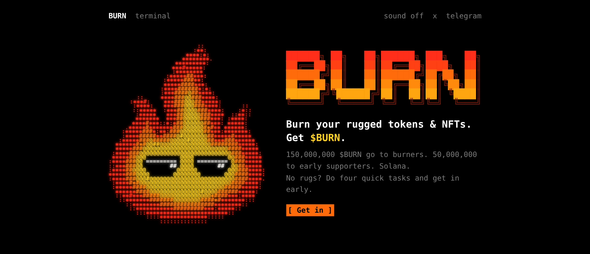
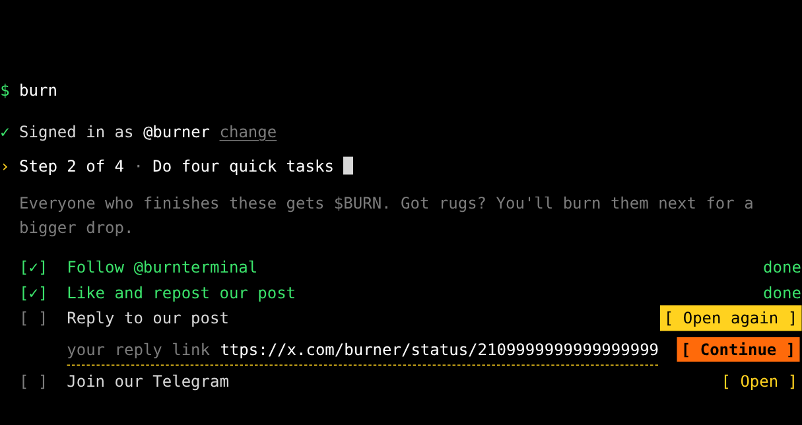
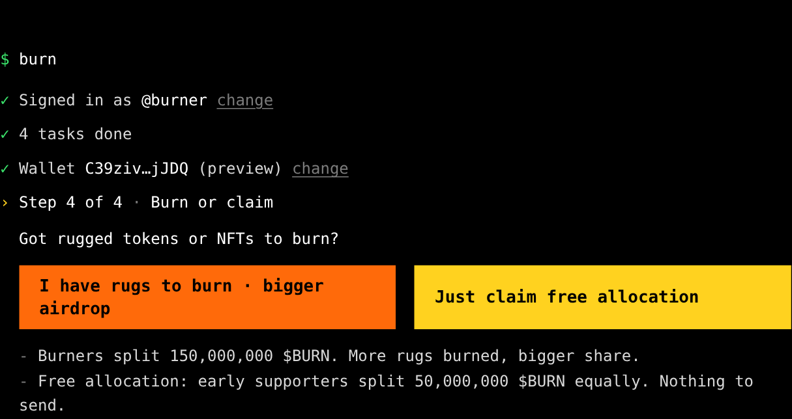
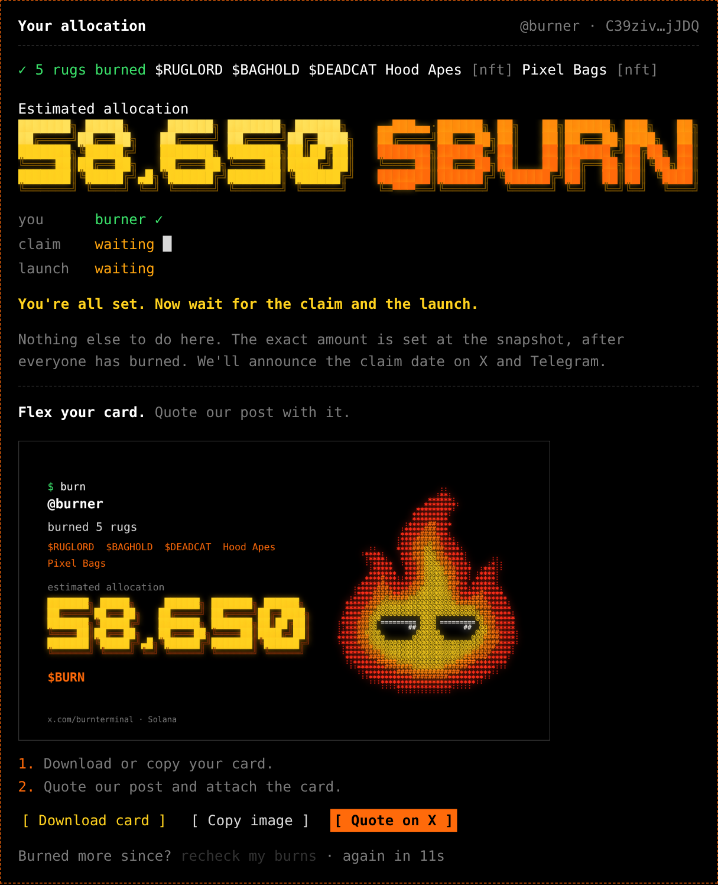

<p align="center">
  
</p>

<h3 align="center">Burn your rugged Solana tokens &amp; NFTs. Get <code>$BURN</code>.</h3>

<p align="center">
  <a href="https://burnterminal.com"><b>burnterminal.com</b></a>
  &nbsp;·&nbsp;
  <a href="https://x.com/burnterminal">X</a>
  &nbsp;·&nbsp;
  <a href="https://t.me/burnterminal">Telegram</a>
</p>

<p align="center">
  
  
  
  
  
</p>

<p align="center">
  
</p>

---

```
$ burn --help

  Everyone has a wallet full of dead tokens.
  Send them to the burn address, prove it with one click, get $BURN.
  No rugs? Do the tasks and get in as an early supporter.

  no wallet connect · no signatures · one X account = one wallet
```

## How it works

| | Step | What happens |
|:-:|---|---|
| **1** | Sign in with X | OAuth 1.0a. Free, no paid X API calls. The session lives in a signed httpOnly cookie. |
| **2** | Four quick tasks | Follow, like + repost, reply (with a link to your reply), join Telegram. |
| **3** | Your wallet | Paste a Solana address. Nothing to connect, nothing to sign. |
| **4** | Burn or claim | Send rugged tokens / NFTs to the burn address and press **check**, or skip and claim as an early supporter. |

<p align="center">
  
  
</p>
<p align="center">
  
</p>
<p align="center"><sub>Screenshots use demo data.</sub></p>

## The drop

```
airdrop: 200,000,000 $BURN
├── 150,000,000  burners
│   ├──  30%  split equally between everyone who burned
│   └──  70%  split by points = min(n, 30) ^ 0.7
│             n = distinct tokens + NFT collections sent to the burn address
└──  50,000,000  early supporters (tasks done, nothing burned), split equally
```

- Each token or NFT **collection** counts once. Sending more of the same adds nothing.
- Up to **30** count per wallet.
- SOL, wSOL, stablecoins and compressed NFTs don't count.
- An early supporter who burns later becomes a burner automatically.
- The site shows an *estimate*. Final numbers are set at the snapshot (`allocation` view).

## Burn detection

One click on **check** = one scan of the wallet's newest transactions since `CAMPAIGN_START`. The wallet is never scanned in the background.

| Asset | How it's detected |
|---|---|
| SPL / Token-2022 tokens | `preTokenBalances` → `postTokenBalances`: the wallet goes down, the burn address goes up, in one successful tx |
| Legacy NFTs (Token Metadata) | same balance deltas, grouped by collection via DAS `getAsset` |
| Metaplex Core | parsed from the Core program's transfer instruction (`asset = accounts[0]`) |
| Compressed NFTs (Bubblegum) | recognised (asset id derived from tree + nonce) but **not counted** |

Cost per check ≈ `40 CU` (`getSignaturesForAddress`) + `40 CU × txs` (`getTransaction`) + `80 CU` per new asset name (cached).
Results are cached for 10 s per wallet, parallel checks are de-duplicated, and Alchemy `429`s are retried with backoff.

## Stack

```
public/                 static site: one HTML file, vanilla JS, no build step
  app.js                the whole flow: steps, tasks, burn check, final card (canvas)
  style.css             terminal look, DejaVu Sans Mono
netlify/
  lib/burn.mjs          config, Supabase REST, Alchemy RPC, burn parsing, drop math
  functions/
    x-login · x-callback · x-manual · logout     sign in with X (OAuth 1.0a)
    me · stats                                   session + public counters
    tasks                                        saves the four tasks
    claim                                        runs the burn check for a wallet
    lock                                         final lock-in: burner or early supporter
supabase/
  schema.sql            claims table (RLS on, no public grants), burn_stats(), allocation view
  migration-*.sql       upgrades for an existing database
```

The browser never talks to the database. Only the Netlify functions do, with the service key.

## Run your own

```bash
git clone https://github.com/<you>/burn-terminal && cd burn-terminal
cp .env.example .env          # fill it in, see below
npx netlify-cli dev           # site + functions on http://localhost:8888
```

Serve `public/` with any static server (`npx serve public`) and, without the functions behind it, the site runs in **demo mode** with sample data.

Full setup (Supabase, X app, Alchemy, Netlify): **[docs/SETUP.md](docs/SETUP.md)**

<details>
<summary><b>Environment variables</b></summary>

| Variable | Required | What it is |
|---|:-:|---|
| `SUPABASE_URL` | ✓ | Supabase project URL |
| `SUPABASE_SERVICE_ROLE_KEY` | ✓ | secret / service-role key, server only |
| `X_CONSUMER_KEY`, `X_CONSUMER_SECRET` | ✓ | X app → Keys and tokens → Consumer Key (OAuth 1.0a) |
| `ALCHEMY_API_KEY` | ✓ | Alchemy app with Solana Mainnet enabled |
| `DEAD_ADDRESS` | ✓ | the Solana burn address (base58, case-sensitive) |
| `SESSION_SECRET` | ✓ | any long random string, signs the login cookie |
| `SITE_URL` | | your domain, used for the X callback |
| `CAMPAIGN_START` | | ISO date; sends before it don't count |
| `EXCLUDE_SYMBOLS` / `EXCLUDE_MINTS` | | tokens that never count |
| `MAX_TX_SCAN` | | newest transactions to look through (default 300) |
| `ALLOW_MANUAL_HANDLE` | | `true` = sign in by typing a handle. Testing only |

</details>

## Snapshot

```sql
select * from public.allocation order by drop_amount desc;                    -- the drop per wallet
select kind, count(*), sum(drop_amount) from public.allocation group by kind; -- burner ≈150M, early ≈50M
```

## Notes

- Social tasks are honour-based on purpose (the X API that could verify them is paid). The reply task checks the link's format and that it was posted by the signed-in account.
- Sent tokens and NFTs are gone for good. Nothing is ever returned.
- Nothing here is financial advice, and `$BURN` comes with no promise of value.

<p align="center"><br><code>$ burn</code><br><sub>dead bags in → $BURN out</sub></p>
